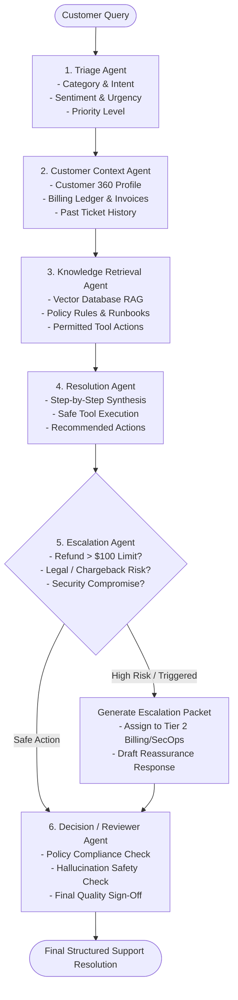

# Agentic AI Customer Support Resolution System

An enterprise-grade, autonomous **Multi-Agent AI Customer Support Resolution System** engineered to understand complex customer issues, retrieve customer 360 context and vectorized support policies, synthesize step-by-step resolution plans, execute safe write tools, escalate high-risk transactions to human specialists, and enforce quality control via a dedicated Decision/Reviewer agent.

---

## 🌟 Key Capabilities

- **6 Specialized AI Agents**:
  1. **Triage Agent**: Intent classification, sentiment analysis, urgency scoring, and priority tagging (`Low`, `Medium`, `High`, `Urgent`).
  2. **Customer Context Agent**: Customer 360 profile retrieval, active subscription tier, billing ledger, past ticket history, and session context.
  3. **Knowledge Retrieval Agent (RAG)**: Vector similarity search over internal support policies, SLA guarantees, and troubleshooting guides.
  4. **Resolution Agent**: Step-by-step resolution synthesis with safe tool execution (`issue_refund`, `apply_billing_credit`, `reset_mfa_device`, `sync_api_quota`).
  5. **Escalation Agent**: Human-in-the-loop risk guardrails (auto-triggers for refunds > $100, legal/chargeback dispute terms, or security breaches) with structured escalation briefings.
  6. **Decision / Reviewer Agent**: Quality assurance, hallucination checks, policy compliance sign-off, and final response approval.
- **Strict Distinction Guarantee**:
  - 📖 **Information Retrieval**: Knowledge snippets and customer account data.
  - 💡 **Recommended Actions**: Advisory guidance steps proposed to the customer.
  - ⚡ **Actions Actually Performed**: Automated tool executions with immutable audit trails.
  - 🚨 **Escalation Packet**: Structured routing to Tier 2 specialist teams when safety thresholds are exceeded.
- **Interactive Multi-Turn Support Chat**: Real-time customer experience with instant one-click scenario templates (Double Charge, High Refund Escalation, MFA Lockout, API 429 Throttle).
- **Visual StateGraph Pipeline**: Real-time telemetry, latency timers, input/output inspection, and reviewer sign-off stamps.
- **Support Operations & Customer 360**: Ticket queue manager, SLA tracker, and customer billing ledger explorer.

---

## 🏗️ Multi-Agent Architecture



---

## 📋 Required Deliverables & Output Breakdown

The system presents the exact structured output required:

| Field | Description | Example (Duplicate Charge Scenario) |
| :--- | :--- | :--- |
| **Ticket Status** | `Resolved` / `Requires More Information` / `Escalated` | `Resolved` |
| **Customer Query** | The raw incoming customer inquiry | *"I was charged twice for my subscription this month..."* |
| **Issue Category** | Classified support domain | `Billing & Payments` |
| **Priority** | Urgency and impact level | `High` |
| **Retrieved Knowledge** | Vector search matches and policy references | `KB-BILL-001` (Duplicate Charge Policy POL-BILL-2025-01) |
| **Suggested Resolution** | Step-by-step guidance strategy | Identified duplicate invoice `#INV-2025-002` for $49.00 and credited back. |
| **Actions Performed** | Tools executed in runtime with audit log | `issue_refund` ($49.00 USD, Status: `SUCCESS`) |
| **Escalation Status** | Human intervention indicator | `None` (or `Escalated to Tier 2 Billing` if > $100) |
| **Agent Execution History** | 6-stage telemetry and reasoning trace | Triage (32ms) → Context (45ms) → RAG (51ms) → Resolution (68ms) → Escalation (18ms) → Reviewer (36ms) |
| **Final Response** | Polished customer-facing delivery | Formatted empathetic response with refund timeline. |

---

## 💻 Technology Stack

### Backend
- **Framework**: Python 3.11 + FastAPI (Async REST APIs)
- **Agent Orchestrator**: LangGraph / Custom StateGraph with typed workflow states
- **LLM Integration**: Google Gemini / OpenAI with deterministic reasoning fallback
- **Validation**: Pydantic v2
- **Database**: PostgreSQL (SQLAlchemy Async) with zero-config SQLite fallback
- **Vector Database**: Semantic Vector RAG with Cosine Similarity scoring
- **Session Memory**: Redis cache + in-memory multi-turn TTL buffer
- **Security**: JWT Authentication (OAuth2 Bearer, RBAC: Customer / Agent / Admin)

### Frontend
- **Framework**: React 18 + TypeScript + Vite
- **Styling**: Tailwind CSS + Custom Glassmorphic Dark UI + Lucide Icons
- **State Management**: React Context API (`TicketContext`, `AuthContext`)

---

## 🚀 Quick Start Guide

### Prerequisites
- Python 3.10+
- Node.js 18+ and npm

---

### 1. Backend Setup

```bash
# Navigate to backend directory
cd backend

# Create and activate virtual environment
python -m venv venv
# On Windows:
venv\Scripts\activate
# On macOS/Linux:
source venv/bin/activate

# Install dependencies
pip install -r requirements.txt

# (Optional) Set environment variables in .env
cp .env.example .env

# Run FastAPI backend server
python run.py
```

The backend server will start on **`http://localhost:8000`**.
- Swagger Interactive Docs: **`http://localhost:8000/docs`**
- Health Check: **`http://localhost:8000/api/health`**

---

### 2. Frontend Setup

```bash
# In a new terminal, navigate to frontend directory
cd frontend

# Install dependencies
npm install

# Start Vite development server
npm run dev
```

The frontend application will start on **`http://localhost:5173`**.

---

### 3. Docker Compose Deployment (Single Command)

```bash
# From the root directory:
docker-compose up --build
```
- Frontend: `http://localhost:5173`
- Backend API: `http://localhost:8000`

---

## 🌐 Cloud Deployment Guide

### Deploy Backend to **Render**
1. Fork or push this repository to GitHub.
2. In the [Render Dashboard](https://dashboard.render.com/), click **New +** → **Blueprint**.
3. Connect your repository — Render will automatically detect [`backend/render.yaml`](backend/render.yaml).
4. Configure optional environment variables (`OPENAI_API_KEY` or `GEMINI_API_KEY`).
5. Click **Apply** to deploy.

### Deploy Frontend to **Vercel**
1. In the [Vercel Dashboard](https://vercel.com/), click **Add New Project**.
2. Select your repository and set the **Root Directory** to `frontend`.
3. Framework Preset: **Vite**.
4. Set Build Command: `npm run build` and Output Directory: `dist`.
5. Click **Deploy**.

---

## 🛡️ Tool Safety & Escalation Matrix

| Tool Name | Category | Safe Limit | Escalation Behavior |
| :--- | :--- | :--- | :--- |
| `get_customer_account` | `READ_ONLY` | Unlimited | Safe read-only execution |
| `get_billing_invoices` | `READ_ONLY` | Unlimited | Detects duplicate invoices |
| `issue_refund` | `SAFE_WRITE` | ≤ $100.00 | Amounts > $100 auto-block and route to **Tier 2 Billing** |
| `apply_billing_credit` | `SAFE_WRITE` | ≤ $50.00 | Account balance credit |
| `reset_mfa_device` | `SAFE_WRITE` | Verified Email | Account security recovery challenge |
| `sync_api_quota` | `SAFE_WRITE` | Standard Limits | Clears 429 rate limit throttle |

---

## 📁 Repository Structure

```
Agentic_Ai/
├── backend/
│   ├── app/
│   │   ├── main.py                     # FastAPI entry point & routers
│   │   ├── config.py                   # Pydantic BaseSettings
│   │   ├── database.py                 # Async SQLAlchemy engine
│   │   ├── models/                     # User, Customer, Ticket, AgentTrace, AuditLog
│   │   ├── schemas/                    # Pydantic request & response models
│   │   ├── core/                       # JWT auth, memory store, seed data
│   │   ├── rag/                        # Vector Store & Support Knowledge Base
│   │   ├── tools/                      # Tool definitions, safe executor, billing tools
│   │   ├── agents/                     # 6 specialized agents & orchestrator
│   │   └── api/                        # REST API endpoints
│   ├── requirements.txt
│   ├── Dockerfile
│   ├── render.yaml
│   └── run.py
│
├── frontend/
│   ├── src/
│   │   ├── components/                 # Chat, Pipeline, Tickets, KB, Customer 360, Analytics
│   │   ├── context/                    # React Context providers
│   │   ├── services/                   # API client & simulation fallback
│   │   ├── types/                      # TypeScript definitions
│   │   ├── App.tsx                     # Main layout & router
│   │   └── index.css                   # Glassmorphism & Tailwind styles
│   ├── package.json
│   ├── vite.config.ts
│   ├── tailwind.config.js
│   ├── vercel.json
│   └── Dockerfile
│
├── docker-compose.yml
└── README.md
```

---

## 🧪 Interactive Test Scenarios

The frontend includes 1-click test scenarios to demonstrate system behavior:
1. **Double Charge Pro Plan**: Classified as `Billing & Payments` (Priority: `High`). Knowledge article `KB-BILL-001` retrieved. Tool `issue_refund` automatically executed ($49.00). Reviewer approves. Status: **`Resolved`**.
2. **Enterprise Refund > $100**: Classified as `Billing & Payments` (Priority: `Urgent`). Amount ($299.00) exceeds $100 threshold. Escalation Agent triggers. Escalation packet generated and assigned to **Tier 2 Billing & Financial Operations**. Status: **`Escalated`**.
3. **MFA Reset Challenge**: Classified as `Account & Security`. Safe tool `reset_mfa_device` executed. Verification link dispatched to customer email. Status: **`Resolved`**.
4. **API 429 Rate Limit**: Classified as `Technical Support`. Tool `sync_api_quota` clears rate limiter caches. Exponential backoff runbook returned. Status: **`Resolved`**.
